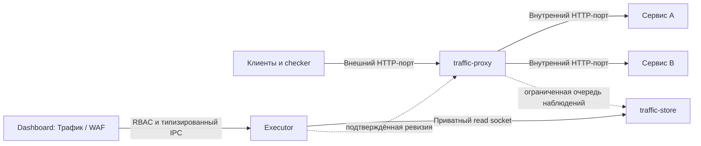

# HTTP Proxy, просмотр трафика и базовый WAF

Версия: 1.5. Дата: 30 октября 2026 года. Статус: **HTTP/1.1, перенос портов, TLS и opt-in HTTP/2→h2c/gRPC реализованы; локальная проверка, без соревновательной приёмки**.

Документ дополняет ТЗ v2.10. Пользователь перенёс повторную приёмку нестабильной VM и поручил продолжить HTTP Proxy/WAF. Разработка идёт параллельно открытым A01–A39; критерии P01–P16 учитываются отдельно. Это решение меняет порядок работ, а не статус приёмки MVP.

## 0. Реализованный профиль и оставшийся объём

Реализованы независимые `ctfm-proxy` / `ctfm-traffic`, opt-in Compose и bootstrap, страницы «Трафик» / «Proxy / WAF», HTTP/1.1 и TLS termination. Основная панель запускается без этого модуля. [Инструкция установки](http-proxy-install.md).

Можно подключить свободный порт к проверенной локальной application-публикации либо отдельно перенести **все существующие TCP-привязки application-компонентов одного сервиса** одним групповым планом. Поддерживаются до 8 компонентов, 16 пар «компонент + контейнерный TCP-порт» и 32 явных IPv4/IPv6 listeners, в разрешённых диапазонах. Каждая пара получает свой уникальный закрытый backend-порт. Неполное покрытие, повторные backend-порты, UDP и неоднозначная неявная dual-stack публикация отклоняются до изменения. БД и другие зависимости не пересоздаются.

Перенос проходит preview/digest → долговечный queued intent → поочерёдное пересоздание выбранных application-компонентов с полным набором их `127.0.0.1:private_port` → сверку образов/хранилищ/runtime после каждого шага → применение proxy на прежних внешних портах → проверку applied revision и настроенных local checks. Исходные Compose-файлы, код и данные не редактируются. Отдельный versioned overlay портов с набором записей и признаком фактического состояния каждого компонента применяется и при последующих Deploy/Rollback/Recover, поэтому обновление кода не возвращает открытый backend. Подтверждённый возврат всей группы восстанавливает исходные порты с **текущими** образами и данными; это не Rollback кода.

Перенос группы имеет общий downtime: это staged-операция с журналом, а не обещание атомарности Docker или отсутствия перерыва. Намерение и наблюдаемый результат фиксируются отдельно для каждого компонента; панель показывает активный и уже обработанные компоненты. При прерывании worker проверяет исходный/private вариант независимо для каждого компонента, включая смешанные состояния. Проверенный компенсирующий возврат разрешён; неизвестные container/mount/image/settings либо чужая политика оставляют `requires_recovery`. Новый план возврата/восстановления доступен в панели и через CLI живого executor. Несколько приложений могут временно отсутствовать: план отдельно перечисляет отсутствующие компоненты, фактический runtime и однозначную сохранённую опору для каждого из них. Пропавшая БД/служебная зависимость или неизвестные хранилища не принимаются за обычный partial switch. При незавершённом переносе новые задания, подтверждения регистрации и публикация proxy-политик блокируются, в том числе между разными CLI-процессами. Startup reconciliation выполняет только единственный worker, без автоматического повторения Compose-команд.

TLS-профиль `https1` поддерживает TLS 1.2+ и ALPN HTTP/1.1. Отдельный opt-in `https2` поддерживает TLS HTTP/2/gRPC → h2c, streaming/trailers/cancel, предварительный protocol handshake и явный `grpc_body` capture; [контракт](traffic-analysis.md). Admin выбирает ID локального immutable-профиля и точный Host; проверяются пара ключ/сертификат, SAN/SNI, порядок/подписи и сроки цепочки. Ключи не входят в policy, браузер или API, каталог TLS монтируется только proxy и только read-only. Ротация использует новый ID. При ошибке сохраняется LKG, привязка ID к цепочке переживает рестарт. Upstream остаётся подтверждённым loopback HTTP. Автоматический ACME/renewal, TLS passthrough inspection, HTTP/2/gRPC не входят в `https1`, а включаются через `https2`. TCP/UDP forwarding и TLS passthrough inspection остаются вне этих профилей.

Общая WAF-политика service scope согласована между маршрутами всех портов; route-specific режим задаётся явно. HTTP/TLS/capture задаются для каждого target, точный Host — при необходимости для каждого внешнего listener, поскольку его значение включает нестандартный порт. Старые preview/overlays читаются как одна entry без изменения прежних digest.

Есть streaming/SSE, WebSocket handshake и счётчики, bounded capture и redaction. Сжатое содержимое передаётся без изменения; его архивное тело опускается с причиной. В простом режиме WAF задаётся один лимит запросов в секунду на IP для всех маршрутов сервиса. Превышение даёт `429` и пятисекундную паузу. Расширенный WAF предоставляет off/observe/enforce, token bucket, временные баны, unban и CIDR exceptions. Переполнение state — `reject_new`. Первые маршруты сервиса начинают с observe_only. Для включения блокировки нужно отдельно подтвердить проверку checker.

Локальные race/API/RBAC/Unix/SQLite/frontend/packaging проверки дополняются реальным TLS-прогоном отдельных процессов. **Compose/CTF checker, реальные игровые данные при переносе и нагрузка `competition-4g` пока не приняты.** Пользователь отложил испытания VM. Матрица P01–P16 разделяет реализацию и эти незавершённые проверки.

## 1. Результат для пользователя

Admin подключает HTTP reverse proxy к выбранным зарегистрированным сервисам. Прокси принимает запросы на внешних адресах/портах и передаёт их на подтверждённые внутренние адреса/порты приложений. В панели появляются страницы «Трафик» и «Proxy / WAF».

На странице «Трафик» доступны общий журнал подключённых сервисов и фильтр по одному или нескольким сервисам. Можно открыть запрос и ответ, посмотреть заголовки, доступное тело, длительность и решение WAF. В «Proxy / WAF» задаются маршруты, лимиты запросов по IP, временные блокировки и исключения; видны действующая ревизия политики и состояние прокси.

«Весь трафик» означает все HTTP-обмены, поступившие через подключённые маршруты, в пределах опубликованных лимитов хранения. Прямые обращения к другим портам и произвольные соединения хоста в этот журнал не попадают. Потери, отсутствие записи и усечение отображаются явно. Полнота архива при любой нагрузке не обещается.

## 2. Установка и границы доверия



- `traffic-proxy` и `traffic-store` поставляются отдельным opt-in Compose-проектом, независимо от `dashboard` + `executor`. Остановка или обновление основной панели не останавливает прокси и recorder.
- Прокси продолжает обработку на последней подтверждённой политике при недоступных dashboard/executor. Недоступный recorder не блокирует пересылку.
- Прокси и recorder работают без Docker socket, executor IPC, служебных БД панели и игровых файловых mounts. Их локальные интерфейсы управления/сбора не публикуются на игровых портах. Управление аутентифицировано и ограничено типизированной конфигурацией.
- Адреса upstream и Docker-сети берутся из подтверждённой политики сервисов. Открытый forward proxy, произвольный upstream из URL клиента и универсальный proxy API отсутствуют. Подключение к дополнительным сетям показывается в плане.
- Хранилище трафика, его квота и резерв свободного места отделены от критического журнала executor. Трафик не включается в backup панели автоматически.
- Engine первого профиля — стандартный Go `net/http` / `httputil.ReverseProxy`; собственный HTTP-парсер не вводится. Proxy использует host network на Linux для loopback backend. Executor сохраняет bridge-сеть и подключается к отдельным приватным control/read Unix-сокетам. Recorder остаётся в собственной bridge-сети; ingest опубликован только на loopback хоста. Учётные данные control/ingest/read разделены.

Если перестал работать сам `traffic-proxy`, маршрутизируемый через него сервис может стать недоступен. Независимость от dashboard не означает автоматического обхода отказавшего прокси. Для этого предусмотрены перезапуск с рабочей политикой и отдельный подтверждённый возврат прямых портов.

## 3. Маршруты и переключение портов

Маршрут содержит `route_id`, `service_id`, компонент, внешний bind IP/port, при необходимости Host, подтверждённый upstream, HTTP/TLS-профиль, лимиты соединений/таймауты, политику capture и ссылку на WAF policy. В первом профиле внешний порт однозначно соответствует маршруту; разделение одного listener по Host допускается только с точными непересекающимися правилами. Path rewriting по умолчанию отключён.

Пример:

```text
0.0.0.0:8081 → traffic-proxy → cyber-bank-api:3000
0.0.0.0:8082 → traffic-proxy → bioguard-web:8000
```

Значения иллюстративные; реальные адреса подтверждаются по зарегистрированной конфигурации. Клиент не может подменить upstream заголовком Host.

Если сервис уже занимает внешний порт, добавление записи маршрута его не освобождает. Admin отдельно подтверждает план переноса порта на proxy: старые/новые bindings, сети, контейнеры к пересозданию, ожидаемый перерыв и точку возврата. Данные, volumes и образы сохраняются; БД и другие незатронутые зависимости не пересоздаются. Прямой внешний доступ к backend закрывается в этом плане, иначе WAF можно обойти. Разрешённые локальные диагностические пути перечисляются явно.

Перед изменением выполняются проверка конфликтов/петель, достижимости upstream, возможности bind, состояния checker и сохранение рабочей политики. Изменение конфигурации портов обновляет доверенную runtime policy и не маскируется обычным Deploy кода. План привязан к ревизиям и фактическому состоянию. Возврат восстанавливает прежние bindings/сети по сохранённой процедуре без отката игровых данных.

## 4. Поддерживаемые протоколы

Пассивный просмотр TCP/UDP-пакетов и classic PCAP реализован отдельным ограниченным bridge-профилем; TCP-потоки, gRPC decoder/descriptors и explicit HTTP/2 termination тоже реализованы: [пакетный захват, этап 10](packet-capture-plan.md). Этот переключатель наблюдений не расширяет протоколы текущего proxy.


Первый проверяемый профиль — HTTP/1.1, включая streaming/chunked, бинарные тела, uploads, SSE и WebSocket upgrade. WebSocket в первом профиле проксируется с записью handshake и счётчиков; просмотр отдельных frames требует последующего расширения. Сжатые тела пересылаются без изменения; в текущем профиле тело для просмотра опускается с `unsupported_content_encoding`. Ограниченное безопасное декодирование остаётся будущей работой.

Метод, URI/query, Host, порядок значений там, где его сохраняет поддерживаемый engine, тело и прикладные ответы не изменяются без явной настройки. Стандартные изменения proxy/hop-by-hop headers документируются. Нет обещания побайтовой прозрачности HTTP или совместимости со всеми специально неоднозначными CTF-запросами: перед включением проверяется конкретный сервис и checker. Небезопасно неоднозначные framing-запросы отклоняются; proxy не использует разные трактовки границ запроса с upstream.

В реализованном TLS-профиле HTTPS inspection доступен при явно настроенной терминации TLS на proxy с сертификатом и ключом, которыми располагает команда. Повторное TLS до upstream пока не поддерживается: backend первого профиля — только подтверждённый loopback HTTP. Ключи не возвращаются через UI/API. TLS passthrough не предоставляет содержимое HTTP для просмотра или request-rate WAF. В `http1/https1` HTTP/2 и gRPC отвергаются; разрешение HTTP/2 относится только к `https2` с h2c backend. Произвольные TCP-маршруты не добавлены.

Для HTTP/2 и gRPC реализован отдельный `https2` профиль; его Linux/CTF checker приёмка открыта. Произвольный TCP/UDP, PCAP и декодирование WebSocket frames — отдельные расширения. Поэтому EyeSee/gRPC и TCP-компоненты neuroLinks не объявляются поддержанными первым HTTP-профилем автоматически.

## 5. Страница «Трафик»

Таблица содержит request ID, UTC/выбранный timezone, сервис и маршрут, effective client IP, метод, URL/path, статус, длительность, объёмы запроса/ответа и WAF decision. Для ответа proxy и ответа upstream отдельно указано происхождение. Запросы, отклонённые WAF, также попадают в журнал; upstream у них не вызывается.

Обязательные возможности:

- «Все сервисы», один/несколько сервисов и маршрут; фильтры времени, IP/CIDR, метода, HTTP status/class, URL и решения WAF.
- Live/pause/resume, ограниченная cursor pagination, поиск в сохранённых метаданных. Обновление не дублирует записи; удалённый ротацией cursor обозначает пропуск.
- Карточка обмена: request/response headers, сохранённые тела с текстовым/hex-просмотром, peer/effective IP и источник, времена/обрывы, upstream, ревизия маршрута/правила и причина ограничения.
- Состояния `in_progress`, `completed`, `aborted`; отдельно признаки `truncated`, `body_not_captured`, `dropped`, `recorder_unavailable`. Долгий streaming имеет промежуточные счётчики и не показывается завершённым заранее.
- Счётчики принятых/пересланных/отклонённых запросов, ошибок upstream, потерь записи и сохранённых/пропущенных байтов. Отсутствие сохранённых записей не выдаётся за отсутствие запросов.

Viewer видит агрегаты и отредактированные метаданные. Подробные заголовки/тела доступны только с отдельным `sensitive_access`; расширение прав требует Admin. Изменение маршрутов, trusted proxies, capture и WAF доступно Admin. Defender просматривает разрешённые данные и может снять конкретный временный бан с комментарием; расширять сети/allowlist, отключать enforcement или менять правила может Admin. Полномочия перепроверяются для каждого API/потока, открытые подписки закрываются после отзыва доступа. Просмотр чувствительных деталей и действия управления аудируются без копирования payload в аудит.

## 6. Capture и хранение

Для маршрута доступны `metadata` и `bounded_body`. Тела сохраняются после явного включения Admin в preview маршрута. Текущие ограничения — до 64 KiB отдельно request/response, срок 60 минут, до 100 000 записей, глобальный физический бюджет SQLite вместе с rollback journal 512 MiB, логический бюджет payload 128 MiB и сервисный бюджет 128 MiB. Физический бюджет оставляет место страницам, индексам и журналу. Сохраняется общий резерв свободного места как минимум 1 GiB при стандартном core reserve. Значения подлежат ограниченной настройке и проверке на прототипе; они не являются гарантией длительности архива при любом потоке.

Сохраняются `observed_bytes`, `captured_bytes`, причина усечения и content encoding. Capture limit не является лимитом пересылаемого тела: больший запрос продолжает передаваться потоково, если отдельная политика допускает его размер. Целые большие uploads/ответы не буферизуются ради UI. Автоматического скрытого sampling нет; перегрузка считается потерей и показывается явно.

Authorization, Proxy-Authorization, Cookie, Set-Cookie и настроенные query/header/body-поля редактируются **до записи и до отправки в браузер**. Для тел поддерживаются ограниченные правила и известные секреты/настроенные шаблоны флагов; неизвестные секреты не обещается распознавать полностью. Для неизвестного формата, где включённое редактирование нельзя безопасно применить в пределах бюджета, сохраняются metadata и причина отсутствия тела. Payload отображается как данные, HTML/JS и ANSI не исполняются; автоматической загрузки внешних ресурсов из него нет.

От proxy к recorder используется неблокирующая ограниченная очередь. При её заполнении, ENOSPC или отказе recorder capture отбрасывается с отдельными счётчиками и маркером пропуска. SQLite, браузер и экспорт не оказывают обратного давления на пересылку. Ротация ограничена временем, байтами и количеством записей; сегменты, незавершённые записи и временные файлы также учитываются. После рестарта публикуются новый collector epoch и восстановленные/неизвестные счётчики; утраченные значения не подменяются нулём.

## 7. Клиентский IP

По умолчанию WAF использует IP TCP peer. Proxy не доверяет полученным от произвольного клиента `Forwarded`/`X-Forwarded-For`. Режим trusted proxy включается Admin для конкретных непосредственных peer CIDR, с одним определённым алгоритмом разбора цепочки справа налево через доверенные hop. Некорректный или неоднозначный заголовок не становится произвольным effective IP. IPv4, IPv6 и IPv4-mapped IPv6 нормализуются одинаково для фильтрации и WAF.

В журнале сохраняются peer IP, effective IP и способ определения. Перед отправкой upstream поддельные forwarded headers удаляются/нормализуются, затем proxy формирует их по утверждённой политике. План предупреждает, что backend будет видеть соединение от proxy и его собственный IP-based logic может измениться. NAT и общий адрес checker нельзя определить достоверно по одному заголовку или User-Agent.

## 8. Базовый WAF

Начальный WAF ограничивает частоту и повторные превышения. Сигнатурные SQLi/XSS-правила, GeoIP, репутационные списки, CAPTCHA и обещание остановить volumetric DDoS в этот выпуск не входят.

| Параметр | Семантика |
|---|---|
| Scope | По умолчанию `service_id + effective IP`, чтобы лимит одного сервиса не банил тот же IP на остальных; route-specific override задаётся явно |
| Режим | `off`, `observe_only`, `enforce`; новый маршрут начинает с `observe_only` |
| Rate/burst | Настраиваемая скорость запросов и допустимый всплеск, один документированный алгоритм, например token bucket с monotonic clock |
| Превышение | В enforce запрос отклоняется до upstream, HTTP `429`, `Retry-After`, идентификатор правила и событие в журнале |
| Автобан | После N превышений за заданное окно IP временно блокируется на заданный TTL в scope сервиса |
| TTL | Обязателен, имеет верхний предел; перезапуск не продлевает бан и не превращает его в бессрочный |
| Исключения | Явные подтверждённые IP/CIDR checker/доверенных источников; отдельно выбирается освобождение от rate и/или autoban |
| Управление | Список активных банов, причина/срок/источник, ручной временный бан Admin, снятие и аудит; глобальные/бессрочные autoban отсутствуют |

Allowlist не отключает capture, а checker exception не выдаётся автоматически по User-Agent, URL или полученному от клиента заголовку. При одном IP за NAT ограничения затрагивают всех его клиентов; это видно в описании политики. Конкретные rate/burst/N/окно/TTL подбираются наблюдением и нагрузочной проверкой сервиса, а не включаются универсальным «безопасным» числом для всех CTF.

IP buckets и bans имеют фиксированные бюджеты/expiry. При массовой смене IP память не растёт неограниченно; активные баны не выбрасываются молча для обхода защиты. Для исчерпания state/WAF error задаётся явная политика: `reject_new` либо `service_limit` с заранее заданным общим пределом сервиса. До включения enforce требуется выбрать и проверить этот режим; произвольного автоматического перехода к неограниченной пересылке нет. Recorder failure не меняет решение WAF. UI различает работающий WAF, `observe_only` и `degraded`.

Проверки выполняются по запросам, а не только по соединениям. HTTP keep-alive не обходит лимит. WebSocket получает admission rate limit для handshake и ограничение числа/длительности соединений по отдельной политике; frames не считаются обычными HTTP-запросами. Лимиты headers/body/соединений/timeouts отделены от capture и показаны в плане.

## 9. Политика, отказы и аварийное управление

Каждое изменение маршрута/WAF проходит diff → preview → подтверждение digest → публикацию desired → активацию и observed revision. В текущей реализации Confirm сохраняет immutable-запись и атомарно публикует файл, watcher proxy применяет его независимо; фоновый publisher executor восстанавливает только подтверждённый экспорт. Preview действует пять минут. История ограничена 1024 preview и 1024 confirmed-записями; исчерпание запрещает новые изменения с явной ошибкой, автоматического удаления истории пока нет. Сначала proxy валидирует новый набор, затем атомарно активирует и подтверждает observed revision. Неверная политика оставляет last-known-good; UI различает desired и applied. Пароли/TLS-ключи не входят в открытый diff. Загрузка runtime policy и административные операции не входят в игровой HTTP listener.

Маршруты, политики и сроки bans переживают перезапуск; rate buckets могут начать новую эпоху с документированным ограниченным burst. Отсутствующая или повреждённая конфигурация не запускает открытый proxy. Ошибка загрузки обязательного WAF state не обозначается как исправная защита; применяется выбранный fallback. Метрики proxy и задержка upstream независимы от метрик dashboard/executor.

Локальный аварийный CLI без web позволяет вернуть предыдущую ревизию, явно отключить enforcement для выбранного сервиса и снять бан. Отключение WAF сохраняет proxy-маршрутизацию. Вывод сервиса из proxy и возврат внешних портов — отдельная операция по сохранённому плану, а не обещание автоматического fail-open при падении proxy.

## 10. Этапы разработки

| Этап | Работы и выходной результат |
|---|---|
| 9.0 — контракт и прототип | Выбор engine, ServiceRoute/WafPolicy/TrafficExchange, HTTP compatibility fixtures, внешний/internal mapping, прототип bypass/rollback; замер overhead и подтверждение бюджета до обещаний производительности |
| 9.1 — proxy и cutover | Отдельный Compose-проект, frozen routes, preflight сетей/портов, staged activation/observed revision, LKG и local recovery; реальный HTTP-сервис сохраняет checker/data после включения и возврата |
| 9.2 — capture и страница «Трафик» | Request/response metadata и bounded bodies, отдельное хранилище/квоты, общий поток и фильтры сервисов, detail/live/pause/cursors, RBAC/redaction/drop counters |
| 9.3 — WAF observe-only | Trusted client IP, per-service per-IP rate/burst, вычисление превышений и будущих банов без блокировки; настройка checker exceptions по реальным проверкам |
| 9.4 — enforcement и bans | 429/Retry-After до upstream, autoban TTL, ручное снятие, bounded IP state/fallback, аудит и аварийное отключение |
| 9.5 — приёмка | Совместимость сервиса/checker, аварии proxy/recorder/control plane, pressure/flood/streaming, сохранность данных, дополнительная задержка и возврат прямого маршрута; заполнение P01–P16 |

30 октября пользователь разрешил начать этапы 9.0–9.5 до повторной приёмки VM. Реализованы свободные маршруты и контролируемый групповой cutover application-компонентов и их TCP-портов, TLS termination и основа 9.0–9.4. Локальные проверки не закрывают этап 9.5 и не меняют A01–A39. Enforce допускается после успешного observe-only прогона конкретного профиля.

## 11. Отдельная матрица приёмки

Ни один критерий пока не принят на целевом Linux/amd64 `competition-4g`. «Частично» ниже означает конкретное локальное свидетельство, а не завершённую соревновательную приёмку. Текущий отчёт: [групповой перенос](../tests/integration/reports/README.md#report-http-proxy-group-cutover-2026-10-30-json). [Однокомпонентный перенос и TLS](../tests/integration/reports/README.md#report-http-proxy-cutover-tls-2026-10-30-json) сохранён как предыдущее свидетельство. [Первый профиль](../tests/integration/reports/README.md#report-http-proxy-prototype-2026-10-30-json) сохранён как историческое свидетельство. Отдельно [сквозной прогон процессов](../tests/integration/reports/README.md#report-http-proxy-process-smoke-2026-10-30-json): два upstream, сохранение method/query/body, изоляция фильтров, redaction, 429/autoban/unban, restart с исходным TTL и пересылка при остановленном recorder — пройдены локально.

| ID | Проверяемый результат | Статус и фактическая граница |
|---|---|---|
| P01 | Два разных внешних порта ведут к правильным зарегистрированным upstream; конфликт bind, неизвестный Host, петля и произвольный upstream отвергаются | **Частично.** На облачном Docker-стенде три прежних внешних порта вернули HTTP 200 через прокси. Отказы по bind/Host/петле и произвольному upstream проверены локально. |
| P02 | Перенос существующего порта и возврат выполняются по плану; флаги/данные и identity хранилищ сохранены; незатронутые зависимости не пересозданы | **Частично.** На облачном Docker-стенде перенесены Bimba, Filestorage и Magazinchik с прежними игровыми портами. Образы, идентичность монтирований и контейнеры зависимостей сверены. Возврат и аварийное восстановление проверены локально; полный цикл с checker на целевом стенде впереди. |
| P03 | Общая страница видит обмены обоих сервисов, фильтры изолируют нужные записи; request и response связаны, WAF-deny виден без upstream вызова | **Частично.** Общий журнал показал шесть контрольных запросов на облачном Docker-стенде. Переход к журналу Bimba применил фильтр сервиса. WAF-deny без upstream вызова проверен локально. |
| P04 | Binary/chunked/uploads/streaming/SSE и WebSocket handshake работают по профилю; проверены методы, query/Host, trailers/обрывы и влияние на checker | **Частично.** Локальные HTTP/binary/chunked/streaming/SSE/WebSocket fixtures пройдены; реальные checker, полный набор trailers/обрывов впереди. |
| P05 | Bodies/header/query redaction не раскрывает контрольные секреты через границы chunks; HTML не исполняется, compression bomb ограничена, неизвестный неподдерживаемый формат не публикуется небезопасно | **Частично.** Redaction до хранения, неполные secret/chunk bodies, RE2 budgets и безопасный text/hex проверены; encoded body опускается, browser/CTF corpus впереди. |
| P06 | Capture prefix/retention/quotas/cursors корректны; большие тела пересылаются полностью при меньшем capture limit, пропуски и усечение видны | **Частично.** Capture prefix, большие потоки, SQLite квоты/retention/cursor-gap/epoch проверены локально; disk pressure на целевом стенде впереди. |
| P07 | ENOSPC, падение recorder, полная очередь и медленный браузер не блокируют пересылку; потери/epoch/reset отображаются явно | **Частично.** Блокирующий sink, queue loss и injected SQLite/reserve failures проверены; реальные ENOSPC/медленный браузер/Compose аварии впереди. |
| P08 | Поддельный XFF/Forwarded не обходит WAF; trusted proxy chain и IPv4/IPv6 нормализованы; peer/effective IP и источник видны | **Частично.** Spoofed headers, trusted chain, ambiguity и IPv4/v6/mapped нормализация проверены; реальная сеть checker впереди. |
| P09 | Проверены границы rate/burst, keep-alive и изоляция IP/scope; observe-only не блокирует, enforce даёт 429/Retry-After до upstream | **Частично.** Token bucket, observe/enforce, service isolation и HTTP 429/Retry-After без upstream проверены; нагрузочная проверка впереди. |
| P10 | N нарушений/окно/TTL, ручное снятие и restart не создают бессрочный бан; отказ/переполнение IP state соответствует объявленному fallback | **Частично.** TTL, restart, manual unban и ограниченное состояние/fail-closed проверены локально; массовый IP churn на VM впереди. |
| P11 | NAT и checker exceptions проверены реальным синтетическим игровым циклом; подделка User-Agent/заголовка не даёт исключение | **Запланировано.** CIDR exceptions реализованы; NAT и реальные игровые checker ещё не приняты. |
| P12 | Неверная/неподтверждённая новая policy не заменяет LKG; версия фиксируется атомарно, desired/applied и ошибки различимы | **Частично.** Preview/digest/CAS, immutable confirm, desired/applied, LKG, bind failure и аварийная более новая ревизия покрыты тестами. |
| P13 | Недоступность dashboard/executor не останавливает proxy; рестарт proxy восстанавливает рабочую policy, CLI возвращает WAF/маршрут по процедуре | **Частично.** Независимые процессы, restore LKG/TTL, отказ recorder и emergency CLI проверены локально; outage/restart в Linux Compose и возврат прямого порта впереди. |
| P14 | RBAC/CSRF/Origin и отзыв открытых потоков защищают capture/config/bans; proxy/recorder не получают Docker/IPC/vault доступа и не становятся открытым proxy | **Частично.** HTTP RBAC/CSRF/Origin, отзыв прав во время RPC, audit и Unix auth проверены; Compose mounts/tokens статически проверены, runtime изоляция впереди. |
| P15 | Измерены RPS, p95/p99 дополнительной задержки, CPU/RAM, connections и bytes при body capture/off, observe/enforce и churn IP. Цели фиксируются после 9.0; результаты сравниваются с прямым доступом на той же VM | **Запланировано.** Численные RPS/p95/p99/CPU/RAM результаты не получены. Caps контейнеров — предварительные, capacity 4 GiB не подтверждена. |
| P16 | TLS termination с контролируемым сертификатом и объявленным ALPN работает; протоколы ограничены выбранным профилем | **Частично; разработка завершена.** `https1` сохраняет HTTP/1.1, `https2` добавляет HTTP/2→h2c/gRPC, bounded streaming/trailers/cancel, preflight и raw capture. Локальные trusted TLS/LKG/restart и реальные отдельные процессы пройдены; Linux/Compose и игровые checker впереди. |

### 11.1. Детализация P02 для группового переноса

Первоначальный локальный профиль использовал имитации Docker/Compose, SQLite и изолированные сетевые/файловые проверки. Результаты исходного прогона приведены в [отчёте группы](../tests/integration/reports/README.md#report-http-proxy-group-cutover-2026-10-30-json). 4 ноября 2026 года на облачном Docker-стенде через панель перенесены исходные публичные порты Bimba `8070`, Filestorage `5000` и Magazinchik `8087` на прокси с закрытыми backend-портами `29080`–`29082`. Внешние IPv4-запросы и IPv6-запросы с самого стенда вернули HTTP 200 и появились в журнале. Полный игровой цикл с checker и возврат на целевом стенде остаются открытыми.

| Подкритерий | Проверяемое поведение | Граница приёмки |
|---|---|---|
| P02-G1 | Полное покрытие app/target-пар, уникальные private ports, ограничения 8/16/32, строгое подтверждение Admin | Локальные API/контракт/UI проверки; Linux Docker предстоит |
| P02-G2 | Несколько TCP-портов одного компонента меняются одним его пересозданием; шаги группы наблюдаются отдельно | Локальный adapter workflow; реальный Compose предстоит |
| P02-G3 | БД/незатронутые компоненты, images/mounts и файлы данных сохранены; возврат после Deploy оставляет текущие образы | На Docker-стенде сверены образы, идентичность монтирований, БД Bimba и оба cleaner-контейнера до и после переноса. Содержимое данных и возврат после Deploy проверены локально. |
| P02-G4 | Ошибка на втором компоненте: original/private/missing варианты сверяются; доказанный возврат либо requires_recovery | Локальные аварийные сценарии; реальные Docker/процессные аварии предстоят |
| P02-G5 | Несколько отсутствующих приложений восстанавливаются только по явной опоре; пропавшая БД и чужие mounts не принимаются | Локальные adapter/SQLite проверки; реальный Docker предстоит |
| P02-G6 | Runtime overlay сохраняет все переносы при Deploy/Rollback/Recover; legacy singular записи возвращаются без изменения прежнего digest | Локальные модели/история; полный игровой цикл предстоит |
| P02-G7 | Volatile health не маскирует и не подменяет строгую проверку ID/image/State/ports/mounts/private runtime | Локальные regression-проверки; длительное наблюдение предстоит |
| P02-G8 | Предварительная проверка конфликтов, IPv4/IPv6, private Docker reservations и журналирования | На Docker-стенде проверены IPv4/IPv6-привязки, внешние IPv4-запросы и журнал. Конфликты и неполный возврат привязок покрыты локальными тестами. |

## 12. Технические основания

- [RFC 6585 §4](https://datatracker.ietf.org/doc/html/rfc6585#section-4): семантика 429 и Retry-After для rate limiting.
- [RFC 7239 §8.1](https://datatracker.ietf.org/doc/html/rfc7239#section-8.1): Forwarded не является достоверным сам по себе; нужна определённая граница доверенных proxy.
- [OWASP Logging Cheat Sheet](https://cheatsheetseries.owasp.org/cheatsheets/Logging_Cheat_Sheet.html): чувствительные данные, безопасное отображение журналов и поведение при отказе записи.
